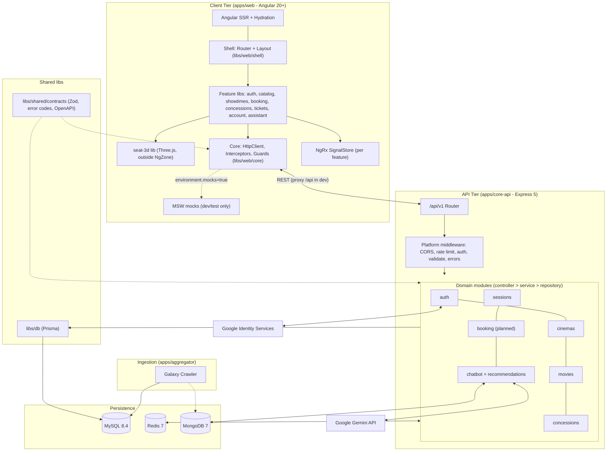

# CineHub Platform - Enterprise Monorepo Specification

## Overview

CineHub is an enterprise-grade digital cinema ticketing platform built as an **Nx monorepo**. It provides real-time showtime aggregation, a 3D Point-of-View (POV) auditorium seat simulation (WebGL/Three.js), an NLP and recommendation engine powered by Google Gemini and vector retrieval, and a multi-tier concurrency pipeline that eliminates double-booking under high load.

The **frontend is an Angular application** (standalone components, Signals, NgRx SignalStore, SSR). The backend is a Node.js modular monolith over a polyglot persistence tier (MySQL 8.4, Redis 7, MongoDB 7), integrated with live Galaxy Cinema datasets.

---

## Architecture Diagram



---

## Table of Contents

1. Architectural Decisions
2. Technology Matrix
3. Monorepo Topology
4. Frontend Architecture (Angular)
5. Network Topology and Ports
6. Onboarding and Local Setup
7. Authentication and Token Lifecycle
8. Command Reference
9. Data Tier and Migrations
10. Concurrency Control and Seat Lease Protocol
11. Engineering Standards, CI and Governance
12. Troubleshooting Runbook

---

## 1. Architectural Decisions

- **Nx Monorepo (npm)**: single lockfile, task caching, `nx affected`, enforced module boundaries via project tags.
- **Domain-driven modular monolith** on the backend; **domain-sliced libraries** on the frontend (`feature` / `data-access` / `ui` / `util`).
- **Contract-first**: Zod schemas in `libs/shared/contracts` generate OpenAPI; the Angular API client and types are generated from it.
- **Polyglot persistence**: MySQL (ACID source of truth, 39 tables / 27 enums), Redis (atomic seat leases, rate limit, `noeviction` + AOF), MongoDB (raw crawler payloads, reviews, audit, embeddings).
- **Multi-tier concurrency**: Redis lease -> MySQL `READ COMMITTED` transaction -> pre-checkout lease validation.

## 2. Technology Matrix

| Layer              | Technology                                                                                               | Function                                          |
| :----------------- | :------------------------------------------------------------------------------------------------------- | :------------------------------------------------ |
| Workspace          | Nx + npm                                                                                                 | Task orchestration, caching, boundaries           |
| Frontend framework | Angular 20+ (standalone, Signals, zoneless, SSR)                                                         | SPA/SSR application                               |
| State              | NgRx SignalStore, Angular Signals                                                                        | Feature and local state                           |
| HTTP & security    | `HttpClient` + functional interceptors, RxJS                                                             | Auth header, silent refresh, retry, error mapping |
| Forms              | Typed Reactive Forms + Zod validator adapter                                                             | Shared validation with the backend                |
| UI                 | Tailwind CSS v4, Angular CDK / Material 3                                                                | Design system, accessibility                      |
| 3D                 | Three.js (WebGL) in an Angular component                                                                 | Seat POV simulation                               |
| i18n               | Transloco                                                                                                | vi / en                                           |
| API client         | Generated from OpenAPI (`ng-openapi-gen`)                                                                | Type-safe contract                                |
| Mocking            | MSW                                                                                                      | Network-level mocks for dev/test                  |
| Backend            | Node.js 20+ (ESM), Express 5                                                                             | REST API                                          |
| Auth               | JWT, Refresh Token Rotation, Google OAuth 2.0                                                            | Sessions and account linking                      |
| AI                 | Google Gemini, vector similarity                                                                         | Vietnamese intent classification, recommendations |
| Data               | MySQL 8.4 + Prisma 6, Redis 7, MongoDB 7                                                                 | See section 1                                     |
| Quality            | ESLint 9 + angular-eslint, Prettier, Husky, lint-staged, Commitlint, Vitest, Testing Library, Playwright | Lint, format, unit, E2E                           |
| CI/CD              | GitHub Actions (`nx affected`), Docker                                                                   | Build, test, release                              |

## 3. Monorepo Topology

```
cinehub/
├── apps/
│   ├── web/                          # Angular application (thin: bootstrap, app.config, routes, SSR)
│   ├── web-e2e/                      # Playwright end-to-end tests
│   ├── core-api/                     # Node.js modular monolith (Express 5)
│   │   └── src/
│   │       ├── bootstrap/            # app.js (factory), server.js, routes.js
│   │       ├── platform/             # Cross-cutting infrastructure
│   │       │   ├── config/           # env.js (Zod), cors.js
│   │       │   ├── http/             # auth/optionalAuth/rateLimit/validate/errorHandler middleware
│   │       │   ├── security/         # jwt.js, googleOAuth.js
│   │       │   ├── mail/             # mailer.js + templates/
│   │       │   ├── cache/            # redis client, lease (Lua) helpers
│   │       │   ├── observability/    # logger.js (Pino), requestId
│   │       │   └── utils/            # errors.js (AppError), qr.js, text.js
│   │       ├── modules/              # Feature domains (public API via index.js)
│   │       │   ├── auth/             # routes, controller, service, repository, schema
│   │       │   ├── cinemas/
│   │       │   ├── movies/
│   │       │   ├── sessions/
│   │       │   ├── concessions/
│   │       │   ├── booking/          # (planned) seats, Redis lease, orders, tickets
│   │       │   ├── chatbot/          # nlp, session, vector, service
│   │       │   ├── recommendations/
│   │       │   └── health/
│   │       ├── jobs/                 # embed-movies.js
│   │       └── scripts/              # chat-scenario.mjs, gemini-probe.mjs
│   └── aggregator/                   # Ingestion worker
│       └── src/{adapters,jobs,upsert,galaxyClient.js,saveRaw.js,config.js}
├── libs/
│   ├── web/                          # Frontend libraries (tag: scope:web)
│   │   ├── shell/                    # Layout, navigation, route composition  (type:shell)
│   │   ├── core/                     # Interceptors, guards, config, error handler, GoogleAuthService
│   │   ├── shared/
│   │   │   ├── ui/                   # Buttons, dialogs, skeletons (design system)
│   │   │   └── util/                 # Pure helpers (formatters, date utils)
│   │   ├── auth/{feature,data-access}/        # Login, register, verify-email, reset-password
│   │   ├── catalog/{feature,data-access,ui}/  # Home, MovieDetail
│   │   ├── showtimes/{feature,data-access,ui,util}/  # Showtimes, filter bar, showtimeFilters
│   │   ├── booking/{feature,data-access,ui}/  # Seats, Checkout, Result, seat store
│   │   ├── seat-3d/                           # SeatMap3D, SeatPOVScene (Three.js)
│   │   ├── concessions/{feature,data-access}/
│   │   ├── tickets/{feature,data-access}/     # MyTickets
│   │   ├── account/{feature,data-access}/     # Profile
│   │   ├── assistant/{feature,data-access}/   # Chatbot widget, recommendations
│   │   └── testing/                           # MSW handlers, fixtures (formerly mocks/)
│   ├── shared/
│   │   └── contracts/                # Zod schemas, constants, error codes, OpenAPI generation (scope:shared)
│   └── db/                           # Prisma schema, migrations, seed, client (scope:server)
├── data/seed/                        # galaxy_normalized_v3.json, galaxy_concessions.json
├── infra/
│   ├── docker/                       # docker-compose.yml, Dockerfiles (web, core-api, aggregator)
│   └── k8s/                          # (optional) manifests / Helm
├── docs/
│   ├── architecture/                 # C4 diagrams, sequence diagrams
│   ├── adr/                          # Architecture Decision Records (0001-use-nx, 0002-angular-signalstore...)
│   ├── api/                          # Generated OpenAPI spec
│   ├── database/                     # CSDL design document
│   ├── ai/                           # chatbot-and-recommendations.md
│   └── GIT_WORKFLOW.md
├── tools/                            # sync-data.js, generators, scripts
├── .github/{workflows/ci.yml, PULL_REQUEST_TEMPLATE.md, CODEOWNERS}
├── .husky/  .vscode/  .editorconfig  .nvmrc  .prettierrc  .env.example
├── nx.json  eslint.config.js  commitlint.config.js  tsconfig.base.json  package.json
└── README.md
```

## 4. Frontend Architecture (Angular)

### 4.1. Library types and dependency rules

Every library carries two tags. `@nx/enforce-module-boundaries` rejects violating imports at lint time.

| Type tag           | May depend on                         |
| :----------------- | :------------------------------------ |
| `type:app`         | shell, feature, data-access, ui, util |
| `type:shell`       | feature, data-access, ui, util        |
| `type:feature`     | data-access, ui, util                 |
| `type:data-access` | util, `scope:shared` contracts        |
| `type:ui`          | util                                  |
| `type:util`        | util                                  |

| Scope tag      | Rule                                         |
| :------------- | :------------------------------------------- |
| `scope:web`    | May depend on `scope:web`, `scope:shared`    |
| `scope:server` | May depend on `scope:server`, `scope:shared` |
| `scope:shared` | May depend on `scope:shared` only            |

Features never import other features. Cross-feature communication goes through routes, shared stores in `data-access`, or events.

### 4.2. Application conventions

- **Standalone components only**, `ChangeDetectionStrategy.OnPush`, zoneless change detection, `inject()` instead of constructor injection, `@if/@for` control flow.
- **Routing**: every feature exposes a `routes.ts`; the shell lazy-loads with `loadChildren`. Route guards are functional: `authGuard`, `roleGuard('ADMIN')`, `guestGuard`. Resolvers prefetch movie/showtime data.
- **State**: server state in `data-access` SignalStores (`withEntities`, `rxMethod`); UI state in component signals. No global mutable singletons.
- **Forms**: typed Reactive Forms; validators derived from `@cinehub/contracts` Zod schemas.
- **Error handling**: global `ErrorHandler` + HTTP error interceptor mapping `AppError` codes to toast notifications; no raw `console.log`.
- **3D**: `SeatMap3D` / `SeatPOVScene` initialize Three.js inside `NgZone.runOutsideAngular`, dispose geometries/renderer in `DestroyRef.onDestroy`, lazy-loaded with the booking route (Three.js stays out of the main bundle).
- **Performance**: route-level code splitting, `@defer` for below-the-fold blocks, `NgOptimizedImage` for posters, virtual scroll for long showtime lists, budgets enforced in `angular.json`.
- **SSR**: public pages (home, movie detail, showtimes) server-rendered with hydration; booking/checkout are client-only (`renderMode: Client`).
- **Accessibility**: Angular CDK a11y (focus trap, live announcer); WCAG 2.1 AA checks in CI via axe in Playwright.
- **Environments**: `environment.ts` / `environment.development.ts` via `fileReplacements`; no runtime `VITE_*` variables. MSW is enabled only when `environment.useMocks === true`.

### 4.3. Generated API client

```bash
npm run api:spec      # generate docs/api/openapi.json from Zod schemas
npm run api:client    # generate libs/web/shared/data-access api client + types
```

CI fails if the generated client is out of date (`git diff --exit-code`).

## 5. Network Topology and Ports

| Service            | Endpoint                | Protocol        | Role                              |
| :----------------- | :---------------------- | :-------------- | :-------------------------------- |
| Angular dev server | `http://localhost:4200` | HTTP / WS (HMR) | Web UI, proxies `/api` to `:4000` |
| Core API           | `http://localhost:4000` | HTTP / JSON     | REST services                     |
| Prisma Studio      | `http://localhost:5555` | HTTP            | Relational data explorer          |
| MySQL              | `localhost:3306`        | TCP             | Relational store                  |
| Redis              | `localhost:6379`        | RESP            | Locks, cache                      |
| MongoDB            | `localhost:27017`       | Mongo wire      | Document store                    |

`apps/web/proxy.conf.json`:

```json
{ "/api": { "target": "http://localhost:4000", "secure": false, "changeOrigin": true } }
```

## 6. Onboarding and Local Setup

Prerequisites: Node.js >= 20, npm >= 10, Docker + Compose >= 24.

```bash
cp .env.example .env
```

1. **Infrastructure**: `npm run infra:up` then `docker compose -f infra/docker/docker-compose.yml ps`
2. **Dependencies**: `npm install` (installs workspaces, configures Husky)
3. **Database**: `npm run db:migrate && npm run db:seed`
4. **Run everything**: `npm run dev` (Nx runs `core-api` and `web` in parallel)

Access: Web `http://localhost:4200`, API health `http://localhost:4000/api/health`, Prisma Studio `npm run db:studio`.

## 7. Authentication and Token Lifecycle

JWT + Refresh Token Rotation (RTR), protected against XSS, CSRF and token theft.

```
[Angular HttpClient]                                  [Core API]
  | 1. POST /api/v1/auth/login ---------------------->|
  |<-- 2. accessToken (15m) + refresh cookie ----------|
  | 3. GET /api/* (Authorization: Bearer) ------------>|
  |<-- 4. 200 -----------------------------------------|
  | ... accessToken expires ...                        |
  | 5. GET /api/* ------------------------------------>|
  |<-- 6. 401 TOKEN_EXPIRED ----------------------------|
  | [authInterceptor: single shared refresh$ in flight]|
  | 7. PUT /api/v1/auth/refresh-token (cookie) ------->|
  |<-- 8. new accessToken + rotated cookie -------------|
  | 9. All waiting requests replay with new token ---->|
  |<-- 10. 200 ----------------------------------------|
```

### 7.1. Dual token strategy

- **Access token** (15 min, HS256, `JWT_ACCESS_SECRET`): `{ sub, role, email }`, sent as `Authorization: Bearer`.
- **Refresh token** (7 days, `JWT_REFRESH_SECRET`): stored as SHA-256 hash in `refresh_tokens`; delivered only via HTTP-only, `SameSite=Strict` cookie (`path=/api`).

### 7.2. RTR and reuse detection

Each refresh revokes the presented token and issues a new one in the same `familyId`. Presenting a revoked token terminates the whole family and all of its sessions.

### 7.3. Google OAuth 2.0 and account linking

Client obtains an ID token via Google Identity Services (wrapped by `GoogleAuthService`), then calls `POST /api/v1/auth/google`. The server verifies it with `google-auth-library` and: (1) finds by `googleId`; (2) else by verified `email` and links `googleId`; (3) else creates a `GOOGLE` account with `passwordHash = null`.

### 7.4. Email verification (OTP) and password reset

- Register generates a 6-digit OTP (SHA-256 salted with `userId`, 10-minute expiry) sent via Mailtrap; `verify-email` issues the session and sends a welcome email; `resend-verification` has a 60 s cooldown.
- `forgot-password` stores a hashed random token (15 min) and always returns a generic response; `reset-password` validates the token, hashes the new password with bcryptjs (cost 10), and revokes all refresh tokens across devices.

### 7.5. Angular interceptor design (replaces `isRefreshing` + `failedQueue`)

```ts
// libs/web/core/src/lib/auth/auth.interceptor.ts
let refresh$: Observable<string> | null = null;

export const authInterceptor: HttpInterceptorFn = (req, next) => {
  const auth = inject(AuthStore);
  const withToken = (r: HttpRequest<unknown>, t: string | null) =>
    r.clone({ withCredentials: true, setHeaders: t ? { Authorization: `Bearer ${t}` } : {} });

  return next(withToken(req, auth.accessToken())).pipe(
    catchError((err: HttpErrorResponse) => {
      if (err.status !== 401 || err.error?.code !== 'TOKEN_EXPIRED' || req.url.includes('/auth/')) {
        return throwError(() => err);
      }
      refresh$ ??= auth.refresh().pipe(
        finalize(() => (refresh$ = null)),
        shareReplay({ bufferSize: 1, refCount: false }),
      );
      return refresh$.pipe(switchMap((token) => next(withToken(req, token))));
    }),
  );
};
```

All concurrent 401s subscribe to the same `refresh$`; one request is made and every waiting call replays with the new token. If refresh fails, `AuthStore` clears the session and the router redirects to login.

### 7.6. Auth endpoints (`/api/v1/auth`, alias `/api/auth`)

| Method | Endpoint               | Protection | Description                            |
| :----- | :--------------------- | :--------- | :------------------------------------- |
| POST   | `/register`            | Public     | Register; emails OTP                   |
| POST   | `/verify-email`        | Public     | Verify OTP; sets session               |
| POST   | `/resend-verification` | Public     | Resend OTP (rate-limited)              |
| POST   | `/login`               | Public     | Credentials login; sets refresh cookie |
| POST   | `/logout`              | Public     | Revokes refresh token, clears cookie   |
| PUT    | `/refresh-token`       | Public     | Rotates refresh token                  |
| GET    | `/me`                  | Bearer     | Current user profile                   |
| POST   | `/google`              | Public     | Google ID token login                  |
| POST   | `/forgot-password`     | Public     | Sends reset email                      |
| POST   | `/reset-password`      | Public     | Completes reset                        |

## 8. Command Reference

| Command                                               | Description                                                   |
| :---------------------------------------------------- | :------------------------------------------------------------ |
| `npm run dev`                                         | `nx run-many -t serve -p web,core-api`                        |
| `npm run dev:web` / `dev:api`                         | `nx serve web` / `nx serve core-api`                          |
| `npm run build`                                       | `nx run-many -t build` (all projects)                         |
| `npm run build:web`                                   | Production Angular build (SSR)                                |
| `npm run affected:test`                               | `nx affected -t lint test build`                              |
| `npm test`                                            | Unit tests across all projects                                |
| `npm run e2e`                                         | `nx e2e web-e2e` (Playwright)                                 |
| `npm run lint` / `format`                             | ESLint (angular-eslint) / Prettier                            |
| `npm run graph`                                       | `nx graph` (dependency visualization)                         |
| `npm run api:spec` / `api:client`                     | Generate OpenAPI spec / Angular API client                    |
| `npm run sync:live`                                   | Regenerate the movie and live-session snapshots               |
| `npm run crawl:galaxy`                                | Crawl Galaxy and upsert movies, cinemas, rooms, and showtimes |
| `npm run infra:up` / `infra:down`                     | Start / stop MySQL, Redis, MongoDB                            |
| `npm run db:migrate` / `seed` / `studio` / `validate` | Prisma operations (`libs/db`)                                 |

To refresh showtimes from Galaxy, configure `.env`, start the required database services, apply
migrations if needed, then run `npm run crawl:galaxy`. The crawler writes current provider data to
the database and regenerates the frontend snapshots. If the live sessions API is unavailable, the
snapshot step fails rather than shifting old seed showtimes to today's date.

## 9. Data Tier and Migrations

Schema change procedure (`libs/db/prisma/schema.prisma`):

1. `npm run db:migrate -- --name <snake_case_name>`
2. `npm run generate -w @cinehub/db`
3. Commit `schema.prisma` and the new `migrations/*` SQL together.

The idempotent seeder covers seat types (`STANDARD`, `VIP`, `SWEETBOX`), ticket tiers (Adult, Student, Child, Member), cinema chains (Galaxy, CGV, Lotte, BHD Star), 12 provincial regions, auditorium and seat map generation, and concession pricing.

## 10. Concurrency Control and Seat Lease Protocol

```
[Select seat] -> [Redis Lua check]
      | locked                | free
 [409 Conflict]   [SET seat:{showtime}:{seat} {user}:{ts} NX EX 900]
                              |
                    [Client shows HOLD state]
                              |
                   [Checkout within 15 min?]
                     yes /          \ no (TTL expired)
  [MySQL tx: validate lease,    [Redis evicts key,
   insert Order + Tickets,       seat released]
   status=BOOKED, DEL lease]
```

1. **Acquire**: `seat:{showtime_id}:{seat_id}` = `{user_id}:{timestamp}`, TTL 900 s.
2. **Atomic verification**: concurrent selections fail in Redis before reaching MySQL.
3. **Checkout**: lease ownership validated inside a `READ COMMITTED` MySQL transaction with row locks.
4. **Release/expire**: payment success sets `BOOKED` and deletes the key; otherwise TTL returns the seat to inventory.

The Angular `booking` store mirrors lease state with a countdown signal and releases the seat on route leave.

## 10.1 Booking, Payment & Verification Flow

### 1. Luồng chặn đăng nhập khi chọn suất chiếu (`returnUrl`)

- Khách vãng lai chưa đăng nhập **vẫn xem được toàn bộ lịch chiếu** tại `/showtimes` và các khung giờ chiếu.
- Khi người dùng **bấm chọn một suất chiếu cụ thể**, hệ thống kiểm tra trạng thái xác thực:
  - Nếu chưa đăng nhập: hiển thị toast thông báo _"Vui lòng đăng nhập để tiếp tục đặt vé"_ và điều hướng sang `/auth?returnUrl=/seats/:showtimeId?...`.
  - Sau khi đăng nhập (hoặc đăng ký / Google Login / Demo Login) thành công, hệ thống tự động đưa người dùng vào thẳng trang chọn ghế của suất chiếu đó.
  - Các route `/seats/:showtimeId` và `/checkout` được bảo vệ bằng `authGuard` để chống truy cập trực tiếp bằng URL khi chưa đăng nhập.

### 2. Sơ đồ ghế thời gian thực & Cơ chế giữ chỗ

- **Không giữ ghế trống ở ngOnInit**: Chỉ gọi API `POST /api/v1/showtimes/:showtimeId/seat-holds` khi người dùng bấm chọn ghế.
- **Xử lý xung đột (409 Conflict)**: Khi hai người dùng cùng bấm vào một ghế, server trả về `409 SEAT_TAKEN`, frontend hiển thị thông báo ghế đã có người giữ và tải lại sơ đồ ghế ngay lập tức.
- **Thăm dò định kỳ (Polling)**: Cứ mỗi 7 giây, giao diện tự động gọi `GET /api/v1/showtimes/:showtimeId/seats` để cập nhật ghế vừa được người khác giữ/mua.
- **Đồng hồ đếm ngược**: Hiển thị thời gian thực dựa vào `expiresAt` từ server. Khi hết giờ, tự động xóa danh sách ghế đang chọn và làm mới sơ đồ.
- **Nguyên tắc nhả ghế**:
  - Không bao giờ nhả ghế trong `ngOnDestroy` khi chuyển tiếp sang bước Chọn bắp nước (`/concessions`) hoặc Thanh toán (`/checkout`).
  - Chỉ nhả ghế khi người dùng bấm bỏ chọn ghế hoặc bấm nút _"Quay lại lịch chiếu"_.

### 3. Thanh toán Sandbox & 3 Đường báo kết quả

Hỗ trợ 3 cổng thanh toán phổ biến: **MoMo**, **VNPAY**, **ZaloPay** qua 3 đường đối soát:

1. **Đường 1 (Webhook IPN)**: Cổng thanh toán gọi webhook backend (`/api/v1/payments/...`). Backend xác thực chữ ký HMAC và chuyển trạng thái đơn sang `CONFIRMED`.
2. **Đường 2 (Đối soát chủ động)**: Khi khách quay lại từ cổng thanh toán, frontend gọi `POST /api/v1/booking/:id/payments/refresh` để đối chiếu với gateway/server. Tuyệt đối không tin `resultCode` trên query URL.
3. **Đường 3 (Dev Simulation)**: Trong môi trường `PAYMENT_ENV=sandbox` và `PAYMENT_SIMULATION=true`, giao diện modal cung cấp nút bấm _"Giả lập thanh toán thành công"_ gọi `POST /api/v1/dev/payments/:paymentId/simulate`.

- **Trang kết quả (`/result/:bookingId`)**: Thăm dò trạng thái mỗi 2.5 giây cho đến khi đơn vé được xác nhận, sau đó hiển thị mã QR vé điện tử (kích thước >= 220px, nền trắng, viền trắng) sẵn sàng để quét check-in tại rạp qua `POST /api/v1/tickets/scan`.

## 11. Engineering Standards, CI and Governance

Feature Branch Workflow; **direct pushes to `main` are prohibited** (see `docs/GIT_WORKFLOW.md`).

- **Conventional Commits** enforced by Husky + Commitlint (`feat|fix|refactor|docs|chore|test(scope): lowercase subject, no trailing period`). Scope = Nx project name.
- **Lifecycle**: `git checkout main && git pull` -> `git checkout -b <type>/<slug>` -> commit -> `git fetch && git rebase origin/main` -> `git push -u origin <branch>` -> PR.
- **CI** (`.github/workflows/ci.yml`): `nx affected -t lint test build`, API client drift check, Playwright E2E on `main`; remote cache enabled.
- **CODEOWNERS**: each `apps/*` and `libs/*` project has an owning reviewer.
- **ADR**: significant decisions (Nx, Angular + SignalStore, contract-first API) recorded in `docs/adr/`.
- **Quality gates**: lint-staged on pre-commit, bundle budgets, coverage threshold per project.

## 12. Troubleshooting Runbook

| Symptom                                        | Remediation                                                                              |
| :--------------------------------------------- | :--------------------------------------------------------------------------------------- |
| Outdated showtimes in UI                       | `npm run crawl:galaxy`, then reload the page                                             |
| `Environment variable not found: DATABASE_URL` | `cp .env.example .env`                                                                   |
| Port 3306 in use                               | Remap Docker to `3307:3306` and update `DATABASE_URL`, or stop native MySQL              |
| `@prisma/client did not initialize yet`        | `npm run generate -w @cinehub/db`                                                        |
| Husky permission denied                        | `chmod +x .husky/*`                                                                      |
| Cookie not sent / CORS error in dev            | Run via `ng serve` with `proxy.conf.json`; do not call `:4000` directly from the browser |
| Nx boundary lint error                         | Check project tags in `project.json`; move shared code to a `util`/`ui` lib              |
| Stale Nx cache                                 | `npx nx reset`                                                                           |

---

_CineHub Enterprise Architecture - Internal Technical Documentation._
