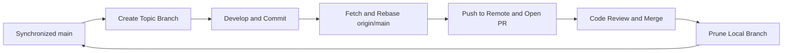

# Git and GitHub Workflow Specification - CineHub Engineering

This document establishes the official version control policy and branch lifecycle standards for the CineHub engineering team. Adherence to this specification guarantees a clean, linear commit history, prevents merge conflicts, and ensures high software reliability across the monorepo.

---

## 1. Core Principles

1. Direct commits and pushes to the `main` branch are strictly prohibited.
2. Every feature, bug fix, or refactor must be developed in its own isolated branch.
3. Always synchronize local `main` with the latest remote state before creating any new branch.
4. Strictly follow the Conventional Commits specification for all commit messages.
5. Never commit sensitive data or build artifacts. All `.env` files, credentials, logs, and dependencies must remain in `.gitignore`.

---

## 2. Development Lifecycle Overview



---

## 3. Standard Six-Step Workflow

### Step 1: Synchronize Local Main

Before starting work on any task, ensure that your local `main` branch is clean and up to date with the remote repository:

```bash
git checkout main
git pull origin main
```

---

### Step 2: Create a Dedicated Topic Branch

Branch names must be concise, descriptive, and follow the standard prefix taxonomy:

- `feat/<task-slug>`: New user-facing or platform features (e.g., `feat/vnpay-payment`, `feat/seat-map-3d`)
- `fix/<task-slug>`: Defect fixes or bug remediation (e.g., `fix/showtime-dates`, `fix/auth-token-refresh`)
- `refactor/<task-slug>`: Structural code improvements without behavioral changes
- `docs/<task-slug>`: Documentation additions or updates
- `test/<task-slug>`: Automated test additions or modifications
- `chore/<task-slug>`: Build configuration, dependencies, or tooling adjustments

```bash
git checkout -b feat/your-task-slug
```

---

### Step 3: Implement Changes and Create Atomic Commits

Break work down into cohesive, atomic commits with explicit commit messages:

```bash
git status
git add .
git commit -m "feat(web): integrate vnpay checkout component"
```

Conventional Commits standard format:

- `feat(scope): concise description`: New functionality
- `fix(scope): concise description`: Bug remediation
- `refactor(scope): concise description`: Code restructuring
- `docs(scope): concise description`: Documentation adjustments
- `chore(scope): concise description`: Dependency or build updates
- `test(scope): concise description`: Test suite adjustments

Rule: Subject lines must remain all-lowercase and must not terminate with a period.

---

### Step 4: Rebase Against Remote Main (Mandatory Zero-Conflict Check)

During branch development, other team members may have merged changes into `main`. To maintain a linear commit history and eliminate merge conflicts before creating a Pull Request, rebase against remote `main`:

```bash
git fetch origin
git rebase origin/main
```

- If no conflicts occur: Git will output `Successfully rebased and updated`.
- If a conflict occurs:
  1. Inspect the conflicting files highlighted in your editor.
  2. Resolve the conflicts by selecting the correct code version.
  3. Stage the resolved files: `git add <file-path>`.
  4. Continue the rebase: `git rebase --continue`.
  5. Never execute `git rebase --skip` unless you fully understand the consequences.

---

### Step 5: Push Branch and Open a Pull Request

Once rebased cleanly on top of `origin/main`:

```bash
git push -u origin feat/your-task-slug
```

GitHub PR procedure:

1. Navigate to the repository on GitHub and click `Compare & pull request`.
2. Provide a descriptive title and fill out the Pull Request template (overview, technical decisions, test verification).
3. Assign designated reviewers.
4. Ensure all continuous integration (CI) status checks pass before merging.

---

### Step 6: Post-Merge Branch Pruning

Once the Pull Request is merged into `main` on GitHub, delete the local topic branch to keep your workspace organized:

```bash
git checkout main
git pull origin main
git branch -d feat/your-task-slug
git fetch --prune
```

Your local environment is now synchronized with `main`. Repeat Step 1 and Step 2 to begin the next task.

---

## 4. Command Quick Reference

| Operational Goal                  | Git Command                                                                     |
| :-------------------------------- | :------------------------------------------------------------------------------ |
| Start a new task                  | `git checkout main && git pull origin main && git checkout -b feat/<task-slug>` |
| Inspect workspace status          | `git status`                                                                    |
| Create atomic commit              | `git add . && git commit -m "feat(scope): message"`                             |
| Synchronize and prevent conflicts | `git fetch origin && git rebase origin/main`                                    |
| Publish branch to remote          | `git push -u origin <branch-name>`                                              |
| Clean up branch post-merge        | `git checkout main && git pull origin main && git branch -d <branch-name>`      |
| Prune stale remote tracking refs  | `git fetch --prune`                                                             |
| List local and remote branches    | `git branch -a`                                                                 |

---

## 5. Emergency Runbook and Edge Cases

### 1. Uncommitted work started on main by mistake

Transfer all uncommitted working tree modifications to a new topic branch immediately:

```bash
git checkout -b feat/new-task-name
```

### 2. Discard all uncommitted local modifications

Reset the working tree to the last committed state:

```bash
git restore .
```

### 3. Deleting a branch rejected by Git (`error: The branch ... is not fully merged`)

If the changes have already been squashed or rebased and merged into `main` on GitHub, force-delete the local reference:

```bash
git branch -D feat/old-branch-name
```
