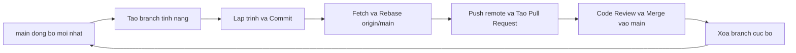

# Quy trinh Lam viec voi Git va GitHub - CineHub Engineering

Tai lieu nay quy dinh quy trinh tieu chuan trong viec quan ly ma nguon, phat trien tinh nang va kiem soat phien ban theo mo hinh Feature Branch Workflow. Muc tieu nham dam bao tinh nhat quan cua lich su commit, ngan ngua xung dot ma nguon (zero conflict) va duy tri chat luong phan mem.

---

## 1. Nguyen tac bat buoc

1. Tuyet doi khong commit hoac push truc tiep len nhanh `main`.
2. Moi tinh nang, sua loi hoac refactor phai duoc thuc hien tren mot branch rieng biet.
3. Luon dong bo ma nguon moi nhat tu remote `main` truoc khi tao branch moi.
4. Tuan thu chat che quy chuan dat ten commit theo dinh dang Conventional Commits.
5. Tuyet doi khong commit thong tin nhay cam: cac file `.env`, credential, build artifact va log phai luon duoc khai bao trong `.gitignore`.

---

## 2. So do vong doi phat trien (Task Lifecycle)



---

## 3. Quy trinh 6 buoc tieu chuan

### Buoc 1: Dong bo nhanh main truoc khi bat dau

Truoc khi thuc hien bat ky cong viec nao, ky su phai dam bao dang dung o nhanh `main` cuc bo va da cap nhat day du cac thay doi moi nhat tu remote repository:

```bash
git checkout main
git pull origin main
```

---

### Buoc 2: Khoi tao branch moi cho cong viec

Ten branch phai ngan gon, ro nghia va tuan theo quy tac tien to:

- `feat/<task-slug>`: Tinh nang moi (vi du: `feat/vnpay-payment`, `feat/seat-map-3d`)
- `fix/<task-slug>`: Khac phuc loi (vi du: `fix/showtime-dates`, `fix/auth-token-refresh`)
- `refactor/<task-slug>`: Tai cau truc ma nguon khong thay doi hanh vi he thong
- `docs/<task-slug>`: Cap nhat tai lieu ky thuat
- `test/<task-slug>`: Bo sung hoac sua doi kiem thu tu dong

```bash
git checkout -b feat/ten-task-cua-ban
```

---

### Buoc 3: Phat trien va tao Commit

Trong qua trinh phat trien, can chia nho cac thay doi thanh cac commit co tinh nguyen tu (atomic commits):

```bash
git status
git add .
git commit -m "feat(web): tich hop giao dien thanh toan vnpay"
```

Dinh dang Conventional Commits bat buoc:

- `feat(scope): mo ta ngan gon`: Tinh nang moi
- `fix(scope): mo ta ngan gon`: Sua loi
- `refactor(scope): mo ta ngan gon`: Tai cau truc ma nguon
- `docs(scope): mo ta ngan gon`: Tai lieu
- `chore(scope): mo ta ngan gon`: Cong viec cau hinh, tooling
- `test(scope): mo ta ngan gon`: Kiem thu

Luu y: Phan mo ta commit viet thuong toan bo chu cai va khong dat dau cham o cuoi cau.

---

### Buoc 4: Kiem tra va ngan ngua Conflict bang Rebase (Bat buoc)

Trong thoi gian phat trien tren branch rieng, cac thanh vien khac co the da merge ma nguon moi vao `main`. De dam bao lich su commit tuyen tinh va branch khong bi xung dot, phai thuc hien rebase tren `origin/main`:

```bash
git fetch origin
git rebase origin/main
```

- Truong hop khong co xung dot: Git se thong bao `Successfully rebased and updated` ngay lap tuc.
- Truong hop co xung dot ma nguon:
  1. Mo trinh soan thao de kiem tra cac vung conflict.
  2. Thong nhat giu lai doan ma dung nhat.
  3. Danh dau file da xu ly: `git add <duong-dan-file>`.
  4. Tiep tuc qua trinh rebase: `git rebase --continue`.
  5. Tuyet doi khong dung `git rebase --skip` neu chua hieu ro thay doi.

---

### Buoc 5: Day branch len Remote va Khoi tao Pull Request (PR)

Sau khi rebase thanh cong tren `origin/main`:

```bash
git push -u origin feat/ten-task-cua-ban
```

Quy trinh tren GitHub:

1. Truy cap repository tren GitHub, chon `Compare & pull request`.
2. Dien tieu de va ban mo ta PR chi tiet theo template (van de ton dong, giai phap ky thuat, ket qua kiem thu).
3. Gan reviewers chiu trach nhiem xem xet ma nguon.
4. Sau khi duoc phe duyet va vuot qua toan bo bo kiem tra CI/CD, tien hanh merge vao `main`.

---

### Buoc 6: Don dep Branch va Chuan bi Task tiep theo

Sau khi PR da duoc merge vao `main` tren GitHub, branch tinh nang da hoan thanh nhiem vu. Can xoa branch cuc bo de giu repository luon sach se:

```bash
git checkout main
git pull origin main
git branch -d feat/ten-task-cua-ban
git fetch --prune
```

Sau buoc nay, moi truong cuc bo da tro ve trang thai chuan nhat. Lap lai Buoc 1 va Buoc 2 de bat dau cong viec tiep theo.

---

## 4. Bang tham chieu lenh nhanh (Cheat Sheet)

| Muc dich thao tac            | Cau lenh Git                                                                    |
| :--------------------------- | :------------------------------------------------------------------------------ |
| Bat dau task moi             | `git checkout main && git pull origin main && git checkout -b feat/<task-slug>` |
| Kiem tra trang thai          | `git status`                                                                    |
| Tao commit                   | `git add . && git commit -m "feat(scope): mo ta"`                               |
| Kiem tra va chong conflict   | `git fetch origin && git rebase origin/main`                                    |
| Day branch len remote        | `git push -u origin <branch-name>`                                              |
| Xoa branch sau khi merge     | `git checkout main && git pull origin main && git branch -d <branch-name>`      |
| Xoa cac tham chieu remote cu | `git fetch --prune`                                                             |
| Kiem tra danh sach branch    | `git branch -a`                                                                 |

---

## 5. Xu ly cac truong hop ngoai le

### 1. Vo tinh viet code khi dang dung o nhanh main (chua commit)

Chuyen toan bo phan code dang sua sang mot branch moi ngay lap tuc:

```bash
git checkout -b feat/ten-task-moi
```

### 2. Huy bo toan bo cac thay doi cuc bo chua duoc commit

Khoi phuc trang thai sach cua working tree:

```bash
git restore .
```

### 3. Gap thong bao loi khi xoa branch cuc bo

Neu branch da duoc merge tren GitHub nhung Git cuc bo canh bao `error: The branch ... is not fully merged` do rebase/squash merge, dung co `-D` de xoa dut diem:

```bash
git branch -D feat/ten-branch-cu
```
