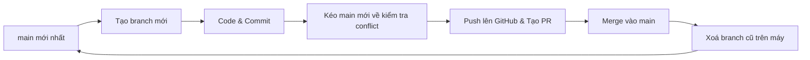

# 🚀 Quy trình Làm việc với Git & GitHub Cho Team CineHub

Tài liệu này hướng dẫn chi tiết quy trình chuẩn từ lúc bắt đầu làm một công việc (Task) mới cho đến khi hoàn thành, merge code và dọn dẹp branch an toàn để **100% không bị xung đột code (conflict)**.

---

## 📌 Nguyên tắc vàng bất di bất dịch

1. **Tuyệt đối KHÔNG commit hoặc push trực tiếp lên nhánh `main`.**
2. **Mỗi Task / Tính năng = 1 Branch riêng biệt.**
3. **Trước khi tạo branch mới: Luôn luôn kéo code mới nhất từ `main` về.**
4. **Không bao giờ commit file bí mật:** Các file `.env`, `node_modules`, log... phải luôn nằm trong `.gitignore`.

---

## 🔄 Vòng đời chuẩn của 1 Task (Từ A đến Z)



---

### BƯỚC 1: Cập nhật nhánh `main` mới nhất trước khi làm task mới

Trước khi bắt tay vào code bất kỳ task nào, bạn phải đảm bảo mình đang đứng ở nhánh `main` và có code mới nhất của cả team:

```bash
# 1. Chuyển về nhánh main
git checkout main

# 2. Kéo code mới nhất từ GitHub về máy
git pull origin main
```

---

### BƯỚC 2: Tạo branch mới cho Task của bạn

Tên branch phải rõ ràng, tuân theo quy tắc:

- `feat/<tên-task>`: Thêm tính năng mới (vd: `feat/momo-payment`, `feat/booking-seats`)
- `fix/<tên-task>`: Sửa lỗi (vd: `fix/showtime-date`, `fix/auth-token`)
- `refactor/<tên-task>`: Tối ưu, viết lại code cũ mà không đổi tính năng

```bash
# Tạo và chuyển sang nhánh mới
git checkout -b feat/ten-task-cua-ban
```

_(Ví dụ: `git checkout -b feat/payment-vnpay`)_

---

### BƯỚC 3: Code và Commit

Trong quá trình làm việc, hãy chia nhỏ và commit thường xuyên:

```bash
# Xem các file vừa sửa đổi
git status

# Thêm các file muốn commit
git add .

# Tạo commit với thông điệp rõ ràng (chuẩn conventional commits)
git commit -m "feat(web): them giao dien thanh toan vnpay"
```

> **Gợi ý viết commit:**
>
> - `feat(...)`: Thêm tính năng mới
> - `fix(...)`: Sửa lỗi
> - `refactor(...)`: Cải tiến cấu trúc code
> - `docs(...)`: Viết tài liệu

---

### BƯỚC 4: Chống Conflict trước khi Push (CỰC KỲ QUAN TRỌNG ⭐)

Trong lúc bạn đang code, có thể đồng đội đã merge code khác vào `main`. Để đảm bảo branch của mình **không bao giờ bị conflict**, hãy chạy 2 lệnh sau:

```bash
# 1. Lấy thông tin mới nhất từ GitHub về
git fetch origin

# 2. Rebase code nhánh mình lên trên code main mới nhất
git rebase origin/main
```

- Nếu không có conflict: Git sẽ báo `Successfully rebased` ngay lập tức!
- Nếu có file trùng nội dung (conflict): VS Code sẽ highlight vùng conflict -> Bạn chỉ cần chọn phiên bản code đúng -> `git add <file>` -> `git rebase --continue`.

---

### BƯỚC 5: Đẩy nhánh lên GitHub & Tạo Pull Request (PR)

```bash
# Đẩy nhánh của bạn lên GitHub
git push -u origin feat/ten-task-cua-ban
```

Sau khi push xong, Terminal sẽ in sẵn đường link tạo PR (hoặc bạn vào GitHub sẽ thấy nút xanh **Compare & pull request**).

1. Bấm vào nút tạo PR.
2. Viết mô tả ngắn gọn những gì bạn đã làm.
3. Nhờ đồng đội Review code và bấm **Merge pull request**.

---

### BƯỚC 6: Xoá Branch cũ & Chuẩn bị làm Task tiếp theo

Sau khi PR đã được merge vào `main` trên GitHub, branch đó đã hoàn thành sứ mệnh. Hãy xoá nó đi để máy tính luôn gọn gàng và không bị nhầm lẫn:

```bash
# 1. Chuyển lại về nhánh main
git checkout main

# 2. Kéo toàn bộ code vừa merge về máy mình
git pull origin main

# 3. Xoá nhánh vừa làm xong trên máy tính của bạn
git branch -d feat/ten-task-cua-ban

# (Tuỳ chọn) Dọn dẹp danh sách nhánh remote đã bị xoá trên GitHub
git fetch --prune
```

👉 **Bây giờ máy của bạn đã hoàn toàn sạch sẽ, `main` đang là phiên bản mới nhất. Lặp lại BƯỚC 2 để bắt đầu Task tiếp theo!**

---

## ⚡ Bảng Lệnh Tắt Nhanh (Cheat Sheet)

| Hành động                   | Lệnh Git                                                                       |
| :-------------------------- | :----------------------------------------------------------------------------- |
| **Bắt đầu task mới**        | `git checkout main && git pull origin main && git checkout -b feat/<ten-task>` |
| **Lưu code (commit)**       | `git add . && git commit -m "feat: mo ta cong viec"`                           |
| **Đồng bộ chống conflict**  | `git fetch origin && git rebase origin/main`                                   |
| **Đẩy lên GitHub**          | `git push -u origin <ten-branch>`                                              |
| **Xong task, dọn branch**   | `git checkout main && git pull origin main && git branch -d <ten-branch>`      |
| **Xem nhánh hiện tại**      | `git branch`                                                                   |
| **Xem trạng thái thay đổi** | `git status`                                                                   |

---

## 🆘 Các tình huống khẩn cấp thường gặp

#### 1. Lỡ sửa code nhưng đang đứng nhầm ở nhánh `main` (chưa commit):

```bash
# Tạo nhánh mới ngay lập tức, code đang sửa sẽ tự động chuyển sang nhánh mới:
git checkout -b feat/ten-task-moi
```

#### 2. Muốn huỷ bỏ toàn bộ những sửa đổi chưa commit:

```bash
git restore .
```

#### 3. Bị báo lỗi khi xoá branch `error: The branch ... is not fully merged`:

Lỗi này xảy ra khi bạn dùng rebase hoặc squash merge. Nếu chắc chắn code đã lên GitHub an toàn, bạn dùng cờ `-D` (viết hoa) để xoá dứt điểm:

```bash
git branch -D feat/ten-branch-cu
```
