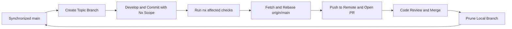

# Git and GitHub Workflow Specification - CineHub Engineering

This document establishes the official version control policy, Nx project scope conventions, and branch lifecycle standards for the CineHub engineering team. Adherence to this specification guarantees a clean, linear commit history, prevents merge conflicts, and ensures high software reliability across the Nx monorepo.

---

## 1. Core Principles

1. Direct commits and pushes to the `main` branch are strictly prohibited.
2. Every feature, bug fix, or refactor must be developed in its own isolated branch.
3. Always synchronize local `main` with the latest remote state before creating any new branch.
4. Strictly follow the Conventional Commits specification for all commit messages, where `scope` is the **Nx project name** (enforced by Commitlint).
5. Never commit sensitive data or build artifacts. All `.env` files, credentials, logs, and dependencies must remain in `.gitignore`.

---

## 2. Development Lifecycle Overview



---

## 3. Standard Six-Step Workflow

### Step 1: Synchronize Local Main

Before starting work on any task, ensure that your local `main` branch is clean and up to date with the remote repository:

```bash
git checkout main
git pull origin main
```

---

### Step 2: Create a Dedicated Topic Branch

Branch names must be concise, descriptive, and follow the standard prefix taxonomy:

- `feat/<task-slug>`: New user-facing or platform features (e.g., `feat/vnpay-payment`, `feat/seat-map-3d`)
- `fix/<task-slug>`: Defect fixes or bug remediation (e.g., `fix/showtime-dates`, `fix/auth-token-refresh`)
- `refactor/<task-slug>`: Structural code improvements without behavioral changes
- `docs/<task-slug>`: Documentation additions or updates
- `test/<task-slug>`: Automated test additions or modifications
- `chore/<task-slug>`: Build configuration, dependencies, or tooling adjustments

```bash
git checkout -b feat/your-task-slug
```

---

### Step 3: Implement Changes and Create Atomic Commits

Break work down into cohesive, atomic commits with explicit commit messages where `<scope>` matches the affected Nx project name:

```bash
git status
git add .
git commit -m "feat(booking): integrate vnpay checkout component"
```

#### Allowed Scopes (Enforced by Commitlint)

- **Apps**: `web`, `web-e2e`, `core-api`, `aggregator`
- **Shared & DB Libraries**: `contracts`, `db`
- **Frontend Domain Libraries**: `shell`, `core`, `shared-ui`, `shared-util`, `shared-data-access`, `auth`, `catalog`, `showtimes`, `booking`, `seat-3d`, `concessions`, `tickets`, `account`, `assistant`, `testing`
- **Cross-Cutting**: `workspace`, `infra`, `docs`, `ci`, `tools`

#### Conventional Commits Format

- `feat(scope): concise description`: New functionality
- `fix(scope): concise description`: Bug remediation
- `refactor(scope): concise description`: Code restructuring
- `docs(scope): concise description`: Documentation adjustments
- `chore(scope): concise description`: Dependency or build updates
- `test(scope): concise description`: Test suite adjustments

Rule: Subject lines must remain all-lowercase and must not terminate with a period.

---

### Step 4: Verify Affected Projects & Rebase Against Remote Main

Run affected checks locally and rebase against `origin/main` before opening a Pull Request:

```bash
npm run affected:test
git fetch origin
git rebase origin/main
```

---

### Step 5: Push Branch and Open a Pull Request

Once rebased cleanly on top of `origin/main`:

```bash
git push -u origin feat/your-task-slug
```

---

### Step 6: Post-Merge Branch Pruning

Once the Pull Request is merged into `main` on GitHub, delete the local topic branch to keep your workspace organized:

```bash
git checkout main
git pull origin main
git branch -d feat/your-task-slug
git fetch --prune
```

---

## 4. Command Quick Reference

| Operational Goal                  | Command                                                                         |
| :-------------------------------- | :------------------------------------------------------------------------------ |
| Start a new task                  | `git checkout main && git pull origin main && git checkout -b feat/<task-slug>` |
| Verify affected projects          | `npm run affected:test`                                                         |
| Inspect dependency graph          | `npm run graph`                                                                 |
| Create atomic commit              | `git add . && git commit -m "feat(scope): message"`                             |
| Synchronize and prevent conflicts | `git fetch origin && git rebase origin/main`                                    |
| Publish branch to remote          | `git push -u origin <branch-name>`                                              |
| Clean up branch post-merge        | `git checkout main && git pull origin main && git branch -d <branch-name>`      |
