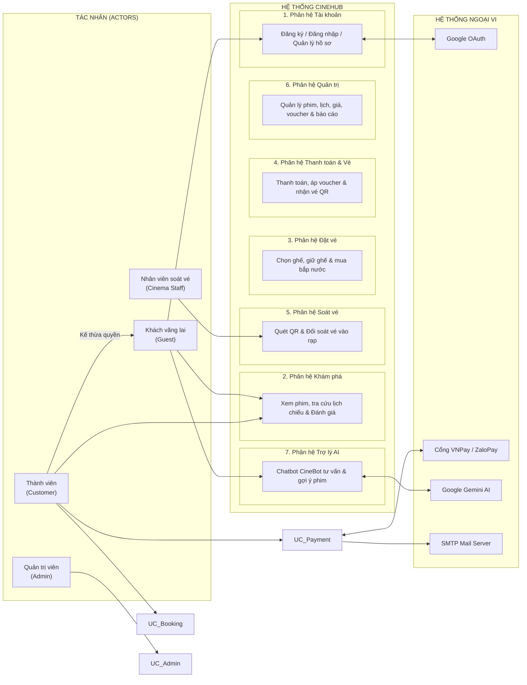
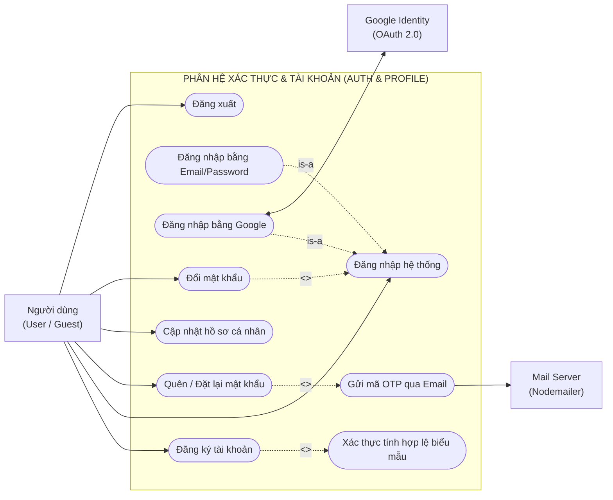
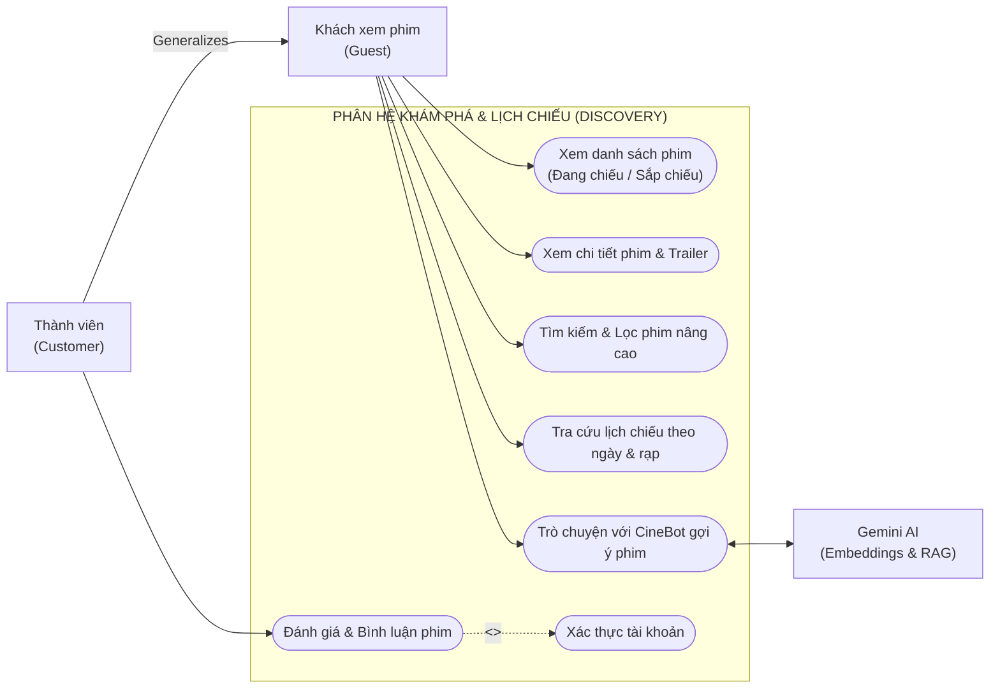
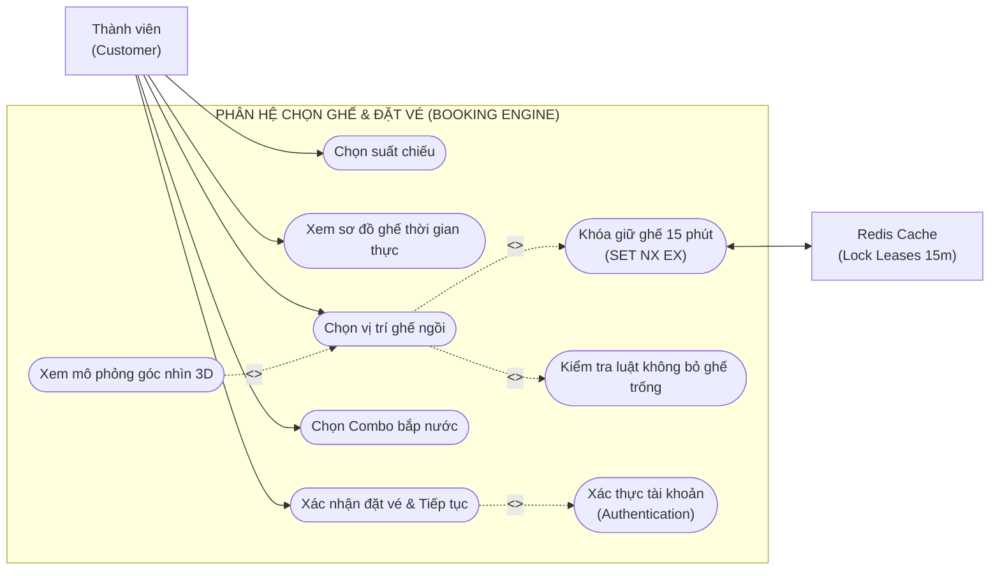
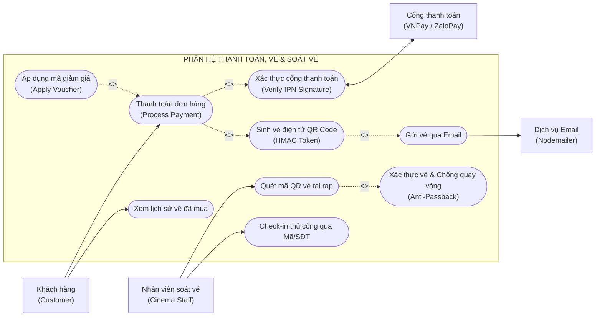
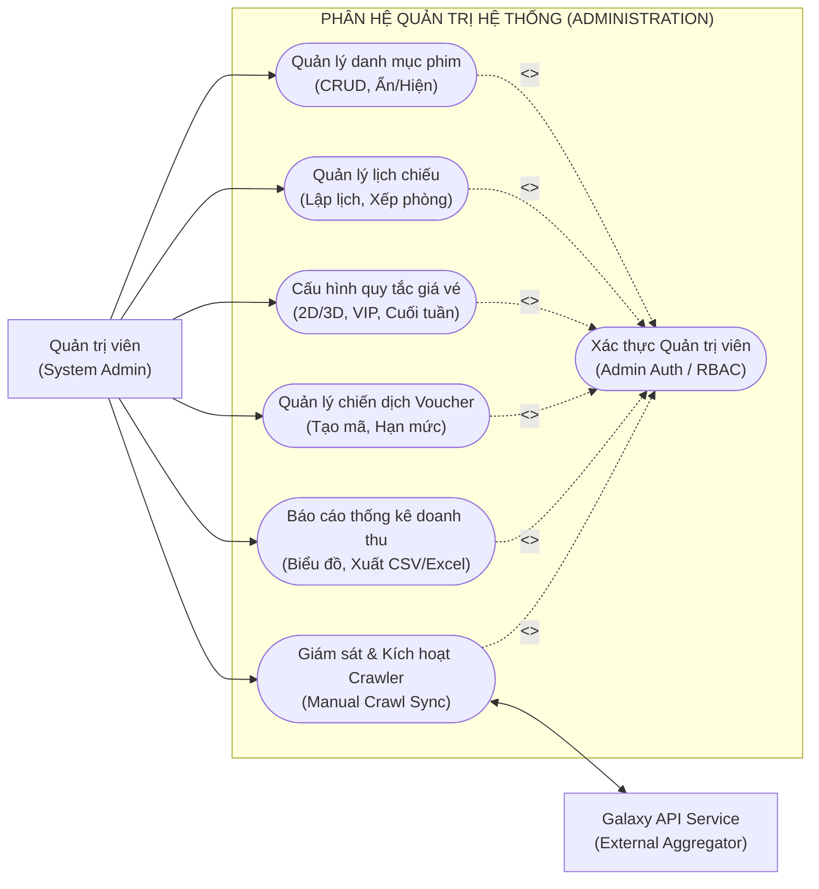
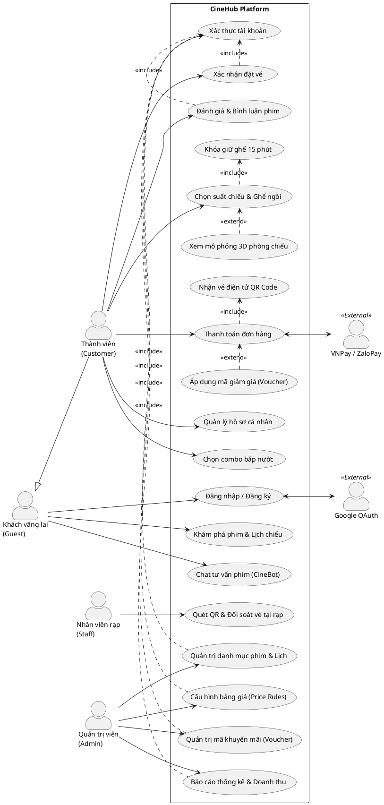

# CINEHUB - BIỂU ĐỒ USE CASE HỆ THỐNG

## D13: Use Case Diagrams (Mục 3.6.1 – 3.6.6)

Tài liệu này bao gồm **6 biểu đồ Use Case** chuẩn UML 2.5 được mô hình hóa bằng cú pháp **Mermaid** (chuẩn tương thích với GitHub, VS Code Mermaid Preview) và kèm mã **PlantUML** tương ứng.

Các quan hệ quan trọng theo yêu cầu đặc tả:

- **`<<include>>` (Bắt buộc bao gồm)**: _Xác thực tài khoản (Authentication)_ được `<<include>>` vào các Use Case quan trọng như Đặt vé, Thanh toán, Đánh giá phim và các chức năng Quản trị.
- **`<<extend>>` (Mở rộng tùy chọn)**: _Áp dụng mã giảm giá / Voucher (Apply Voucher)_ là quan hệ `<<extend>>` mở rộng cho Use Case _Thanh toán đơn hàng (Process Payment)_.

---

### 3.6.1. Biểu đồ Use Case Tổng quan Toàn hệ thống (System Overview)

#### Mô tả các Actor:

- **Khách vãng lai (Guest)**: Khách chưa đăng nhập, có thể tra cứu phim, lịch chiếu, chat hỏi đáp cơ bản với CineBot.
- **Thành viên (Customer)**: Người dùng đã đăng ký, thực hiện đặt vé, giữ ghế, mua bắp nước, áp voucher, thanh toán và quản lý vé.
- **Nhân viên soát vé (Cinema Staff)**: Nhân viên tại rạp thực hiện quét mã QR vé và soát vé vào phòng chiếu.
- **Quản trị viên (System Admin)**: Quản lý toàn bộ danh mục, lịch chiếu, giá vé, voucher, báo cáo doanh thu và crawler.
- **External Systems**: Cổng thanh toán VNPay/ZaloPay, Google OAuth, Galaxy Cinema API, Gemini AI API, SMTP Mail.

---

### 3.6.2. Phân hệ Xác thực & Quản lý tài khoản (Auth & Profile - 3.6.2)

---

### 3.6.3. Phân hệ Khám phá phim & Lịch chiếu (Discovery & Showtimes - 3.6.3)

---

### 3.6.4. Phân hệ Chọn ghế & Đặt vé (Seat Selection & Booking - 3.6.4)

> **Trọng tâm**: Sử dụng quan hệ `<<include>>` Xác thực tài khoản khi tiến hành xác nhận đặt vé và giữ ghế 15 phút.

---

### 3.6.5. Phân hệ Thanh toán, Vé điện tử & Soát vé (Payment, Ticket & Check-in - 3.6.5)

> **Trọng tâm**: Sử dụng quan hệ `<<extend>>` Áp dụng mã giảm giá (Voucher) và `<<include>>` Xác thực giao dịch / Cổng thanh toán.

---

### 3.6.6. Phân hệ Quản trị hệ thống (System & Cinema Administration - 3.6.6)

> **Trọng tâm**: Toàn bộ chức năng quản trị bắt buộc `<<include>>` Xác thực quyền Quản trị viên (Admin Authentication / RBAC).

---

### PHẦN BỔ SUNG: MÃ NGUỒN PLANTUML DÀNH CHO BÁO CÁO WORD / LATEX

Nếu bạn cần xuất ảnh vector chuẩn UML qua PlantUML (PlantText / VS Code PlantUML Extension), dưới đây là mã nguồn tương ứng:

<b>Click để xem mã nguồn PlantUML cho cả 6 biểu đồ</b>

